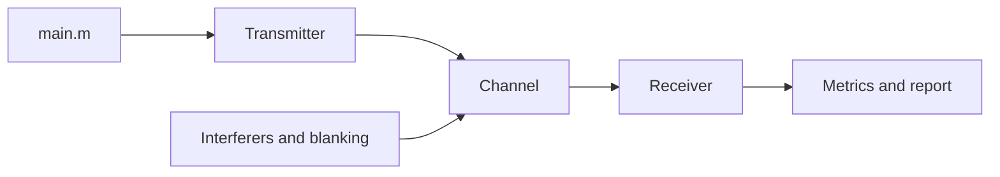

# Link-Level PHY SPMA Simulator

**User and Maintenance Manual**

MATLAB waveform-level simulator for a burst-based Statistical Priority-based Multiple Access (SPMA) physical layer, including interference, avionic propagation, blanking and practical receiver processing. Performance is evaluated through Monte Carlo packet simulations. It does not implement a complete network-level SPMA MAC.

## Quick start

**Requirements:** MATLAB, Communications Toolbox and Signal Processing Toolbox. Python 3 with `openpyxl` is required only for optional Excel export.

1. Clone the repository:
   ```bash
   git clone https://github.com/fraro01/Link-Level-PHY-SPMA-Simulator.git
   ```
2. Open MATLAB and set the Current Folder to the repository root.
3. Edit the scenario parameters in `main.m` (see below).
4. Run `main` in the MATLAB Command Window.
5. Read the final metrics in the Command Window and inspect the diagnostic figures.

Keep the supplied `optimizedPreamble.mat` and `optimizedIndexing.mat` in the root. Preserve all folder names, including MATLAB package prefixes (`+`). The main script sets the auxiliary paths automatically and clears the workspace at startup.

## Configure and run experiments

### Scenario parameters — `main.m`

Change these four variables to reproduce different scenarios:

```matlab
numInterferers = 0;       % Number of interfering nodes
metrics.packets = 100;    % Number of Monte Carlo packets
dutyCycle = 1.0;          % Transmitter duty cycle (0 < value <= 1)
blankingPercentage = 0;   % Receiver blanking fraction (0 to 1)
```

For example, `blankingPercentage = 0.25` represents 25% blanking. For a quick smoke test, use one packet, no interferers, full duty cycle and no blanking. Set `show_metrics_plots = false` for large campaigns.

### Receiver calibration — `+receiver/receiver.m`

#### Blanking compensation

```matlab
minUsableSyncFraction = 0.3;
```

Adjust the minimum usable fraction of synchronization symbols. To disable blanking compensation according to the maintainer's configuration, set `minUsableSyncFraction = 0`. Keep `blankingPercentage` unchanged when comparing receiver algorithms. Setting the latter to zero removes the impairment itself. Verify the zero-setting behavior if a complete mask-processing ablation is required.

#### CA-CFAR burst detection

```matlab
backgroundWindowLength = 500;
guardLength = numSyncSymbols * (32 / 100);
thresholdK = 14;
```

Adjust the background window, guard region and detection threshold multiplier. To replace CA-CFAR with fixed-threshold detection, run the simulator version in `Fixed Detection Threshold`. This alternative folder is not present in the inspected main revision; obtain it separately if needed.

#### DD-SCE

```matlab
localWindowSymbols = 12;
gammaErasure = 70;
```

Adjust the local reliability window and erasure threshold. To disable DD-SCE, set `gammaErasure = inf`. The separate `thresholdDDSCEBER = 0.174` is a ground-truth diagnostic setting, not the operational erasure threshold.

### Other main parameters

| Parameter | Default | Meaning |
|---|---:|---|
| `packetLength` | 1331 | Information bits per packet |
| `numBursts` | 28 | Desired bursts per packet |
| `dutyCycle` | 1.0 | TX activity fraction, in (0, 1] |
| `tunerDelay_s` | 1e-6 | Tuning delay when carrier changes, seconds |
| `fMin`, `fMax` | 1435e6, 1518e6 | Frequency band limits, Hz |
| `numFrequencyChannels` | 4 | Number of hopping channels |
| `rolloff` | 0.35 | RRC roll-off |
| `filterSpan` | 12 | RRC span, symbols |
| `samplesPerSymbol` | 8 | Oversampling factor |
| `cpLength` | 3 | Cyclic prefix, symbols |
| `numInterferers` | 0 | Concurrent interfering nodes |
| `blankingPercentage` | 0.0 | Fraction of observation affected by local TX blanking |
| `channelEstMargin` | 2 | Additional channel-estimation taps/margin |
| `metrics.packets` | 100 | Number of packet trials |
| `show_metrics_plots` | true | Enable first-packet diagnostic plots |
| `rng(123)` | 123 | Reproducible initial random seed |

## Repository structure

```text
.
├── README.md
├── main.m
├── optimizedPreamble.mat
├── optimizedIndexing.mat
├── Monte Carlo Campaigns.xlsx
├── +transmitter/
│   └── transmitter.m
├── +channel/
│   └── channel.m
├── +receiver/
│   └── receiver.m
├── auxiliary external functions/
│   ├── agc_model.m
│   ├── blanking_mask.m
│   └── interferers.m
├── metrics/
│   ├── CalculateMetrics.m
│   └── MetricPlots.m
└── utils/
    ├── design_optimizedPreamble_burstIndexing.m
    ├── generateBurstIndexCodebook.m
    ├── generateOptimizedPreamble.m
    ├── optimized preamble report data.txt
    ├── spectal_precharacterization.m
    ├── baseline validation/
    │   ├── Optimized symbol mapping for bit-interleaved coded modulation with iterative decoding.pdf
    │   ├── baseline_A_validate_8PSK_AWGN.m
    │   ├── baseline_A_validation_8PSK_AWGN.png
    │   ├── baseline_A_validation_8PSK_AWGN_results.csv
    │   ├── baseline_B_waterfall_0to2dB.m
    │   ├── baseline_B_waterfall_0to2dB.png
    │   ├── baseline_B_coded_AWGN.csv
    │   └── readme.txt
    └── report excel writer/
        ├── excel_compiler.py
        ├── report.txt
        └── results.xlsx
```

### Core files

| File | Purpose |
|---|---|
| `main.m` | Configuration, simulation loop, diagnostics and final report. |
| `+transmitter/transmitter.m` | Packet generation, Turbo coding, interleaving, framing, Gray 8-PSK, cyclic prefix, hopping and RRC pulse shaping. |
| `+channel/channel.m` | Link budget, multipath, Rician fading, Doppler, CFO, interference, thermal noise, front-end gain and blanking. |
| `+receiver/receiver.m` | Frequency scanning, AGC/ADC, matched filtering, burst detection, synchronization, LS channel estimation, MMSE SC-FDE, soft demapping, DD-SCE, index recovery and Turbo decoding. |
| `auxiliary external functions/agc_model.m` | RF/digital AGC and ADC model, including clipping, quantization and gain control. |
| `auxiliary external functions/blanking_mask.m` | Generates receiver-local blanking intervals. |
| `auxiliary external functions/interferers.m` | Generates interfering friend waveforms, propagation and detection ground truth. |
| `metrics/CalculateMetrics.m` | Computes and aggregates link and detection performance metrics. |
| `metrics/MetricPlots.m` | Frame, channel taps, channel estimation, detection, CFO and constellation plots. |
| `optimizedPreamble.mat` | Saved synchronization and phase references. |
| `optimizedIndexing.mat` | Saved burst-index codebook and reserved friend codeword. |
| `Monte Carlo Campaigns.xlsx` | Campaign records and results. |
| `README.md` | This manual. |

### Utilities and supporting files

| File (relative to `utils/`) | Purpose |
|---|---|
| `design_optimizedPreamble_burstIndexing.m` | Generates both MAT design artifacts. |
| `generateOptimizedPreamble.m` | Searches for an optimized preamble. |
| `generateBurstIndexCodebook.m` | Designs the index codebook using Hamming distance. |
| `optimized preamble report data.txt` | Stored preamble design report. |
| `spectal_precharacterization.m` | Waveform spectrum, occupied bandwidth, PAPR and nominal throughput analysis. |
| `baseline validation/baseline_A_validate_8PSK_AWGN.m` | Uncoded 8-PSK AWGN validation against theoretical BER. |
| `baseline validation/baseline_A_validation_8PSK_AWGN_results.csv` | Baseline A numerical results. |
| `baseline validation/baseline_A_validation_8PSK_AWGN.png` | Baseline A plot. |
| `baseline validation/baseline_B_waterfall_0to2dB.m` | Turbo-coded 8-PSK AWGN waterfall experiment. |
| `baseline validation/baseline_B_coded_AWGN.csv` | Baseline B numerical results. |
| `baseline validation/baseline_B_waterfall_0to2dB.png` | Baseline B plot. |
| `baseline validation/readme.txt` | Baseline assumptions and validation limitations. |
| `baseline validation/Optimized symbol mapping for bit-interleaved coded modulation with iterative decoding.pdf` | Scientific reference for coded modulation. |
| `report excel writer/excel_compiler.py` | Converts the text report into an Excel row. |
| `report excel writer/report.txt` | Input report for the converter. |
| `report excel writer/results.xlsx` | Generated/example Excel output. |

## Simulation workflow



Each iteration generates and transmits a new packet, applies channel impairments, reconstructs the packet and updates performance statistics. Ground truth is retained for diagnostics.

- **Transmitter:** produces coded, interleaved bursts with synchronization and phase references, protected indices and payload. Bursts are modulated, assigned to hopping channels and placed on a common baseband timeline.
- **Channel:** applies propagation and hardware impairments. Edit the scenario geometry, transmit power (default 48 dBm), path delays, gains, noise figure (2 dB) or oscillator CFO (250 Hz) in `+channel/channel.m`. Edit `interferers.m` for friend-node settings.
- **Receiver:** scans the hopping channels, detects and synchronizes bursts, estimates and equalizes the channel, recovers soft bits, reorders bursts and decodes the packet. Receiver algorithm settings are in `+receiver/receiver.m`; gain-control settings are in `agc_model.m`.

## Results and export

| Metric | Meaning |
|---|---|
| BER before / after decoding | Coded / decoded bit error rate. |
| BLR | Burst loss rate. |
| PER | Packet error rate. |
| SINR | Signal-to-interference-plus-noise ratio. |
| Eb/N0 | Information-bit energy relative to noise spectral density. |
| EVM | Error vector magnitude of equalized payload observations. |
| FDP | False discovery proportion among burst detections. |
| DD-SCE TP, FP, FN, TN | Erasure decision confusion matrix. |
| Precision / recall | DD-SCE decision performance. |

Enable `show_metrics_plots` to inspect first-packet diagnostics. Interpret EVM alongside BLR and PER because missing bursts may not be represented in EVM.

### Export to Excel

1. Install the optional dependency: `python -m pip install openpyxl`.
2. Copy the final MATLAB report into `utils/report excel writer/report.txt`.
3. From the repository root run:
   ```bash
   python "utils/report excel writer/excel_compiler.py"
   ```
4. Open `utils/report excel writer/results.xlsx` and archive or transfer the results to the campaign workbook.

The converter extracts 25 metrics and overwrites `results.xlsx`; it does not automatically append campaign records.

## Validation and design utilities

| Task | How to run |
|---|---|
| Uncoded AWGN validation | Run `utils/baseline validation/baseline_A_validate_8PSK_AWGN.m` and compare BER with theory and the stored CSV/PNG. |
| Coded AWGN validation | Run `utils/baseline validation/baseline_B_waterfall_0to2dB.m` and compare the waterfall with the stored CSV/PNG. External quantitative validation is not yet established. |
| Spectral characterization | Run `main` first, then `spectal_precharacterization` in the same MATLAB workspace. |
| Regenerate preamble and indexing | Back up both MAT files, then run `addpath('utils'); design_optimizedPreamble_burstIndexing` from the root. |

The design driver can perform 100 million preamble trials. Do not rerun it for ordinary simulations. Check the generated MAT files, codebook dimensions and preamble lengths before accepting a new design.

## Maintenance and troubleshooting

| If you change… | Also review… |
|---|---|
| Packet length or burst count | Padding, interleavers, index codebook, interferers and metric denominators. |
| Modulation or mapping | TX, RX, interferers, design utilities and baselines. |
| Bandwidth or sampling rate | Carrier grid, RRC, timing, AGC and spectral analysis. |
| Multipath delays | Cyclic prefix and channel-estimation design length. |
| Report labels | Python Excel parser and campaign workbook columns. |

| Problem | Action |
|---|---|
| Missing functions or MAT files | Check the working directory, package names, toolboxes and supplied artifacts. |
| Cyclic prefix assertion | Check `cpLength >= ceil(delay_max*symbolRate)`. |
| Poor detection | Inspect AGC, blanking, correlation and CA-CFAR settings. |
| High PER despite detection | Inspect CFO, equalization, index recovery, LLRs and decoding. |
| Slow simulation | Reduce packet/interferer counts during debugging and disable plots. |
| Excel export failure | Check all 25 report labels and `openpyxl`. |

For reproducible campaigns, record the Git revision, MATLAB/toolbox versions, RNG seed and scenario settings. Change one factor at a time, run a smoke test after code changes, and increase the packet count for final comparisons. Archive the raw reports before overwriting them.

**Documentation scope:** The minimum supported MATLAB release has not been established.
